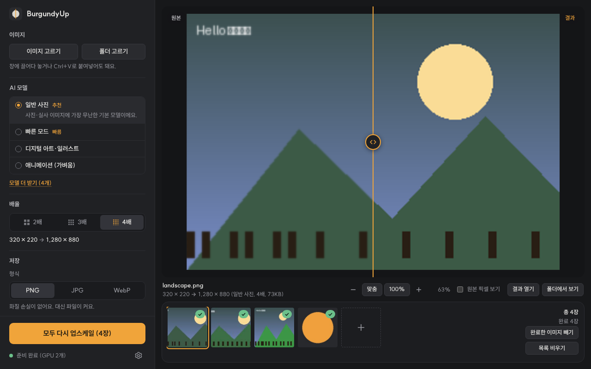

# BurgundyUp
AI 업스케일링 프로그램

**BurgundyUp**은 작거나 흐릿한 이미지를 AI로 2~4배 선명하게 키워 주는 Windows 프로그램입니다.
[Upscayl](https://github.com/upscayl/upscayl)과 같은 엔진(Real-ESRGAN, ncnn + Vulkan)을 써서 그래픽카드로 처리하고, 모든 작업은 내 PC 안에서 이뤄집니다.



## 주요 기능

- 이미지 고르기 · 폴더째 넣기(하위 폴더 포함) · 창에 끌어다 놓기 · Ctrl+V 붙여넣기
- AI 모델: 일반 사진(Real-ESRGAN, Upscayl Standard와 같은 모델) · 빠른 모드 · 디지털 아트 · 애니메이션
- 추가 모델 내려받기: 고화질 디테일, UltraSharp, Remacri, UltraMix (SHA-256 검증)
- 2·3·4배, PNG · JPG · WebP(품질 조절) 저장, 원본 폴더 또는 지정 폴더에 저장
- 원본과 결과를 가운데 선으로 나눠 비교하고, 마우스 휠로 확대해 디테일 확인
- 여러 장을 차례로 처리, 진행률·남은 시간 표시, 언제든 멈추기
- 휴대폰 사진의 회전 정보(EXIF)를 반영해서 결과가 옆으로 눕지 않음
- 그래픽카드 선택, 타일 크기(그래픽 메모리 부족 대비), 고품질(TTA) 모드
- 한국어 화면, 관리자 권한 없이 설치

## 다운로드와 설치

1. [Releases](https://github.com/game-addicted-man/BurgundyUp/releases)에서 `BurgundyUp-Setup-버전.exe`를 받아 실행합니다.
2. "Windows의 PC 보호" 창이 뜨면 **추가 정보 → 실행**을 누릅니다 (서명하지 않은 프로그램이라 나오는 안내).
3. 설치가 끝나면 시작 메뉴나 바탕 화면의 **BurgundyUp**을 실행합니다.

- 설치 위치: `%LOCALAPPDATA%\Programs\BurgundyUp` (관리자 권한 필요 없음)
- 삭제: **설정 → 앱 → 설치된 앱 → BurgundyUp → 제거**
- 설치 없이 쓰려면 `BurgundyUp-버전-portable.zip`을 풀고 `BurgundyUp.exe`를 실행하세요.
- 조용히 설치: `BurgundyUp-Setup-버전.exe /S` (위치 지정은 맨 끝에 `/D=폴더`)
- 예전 이름(AI 업스케일러)으로 설치했다면 새 설치 파일이 알아서 지우고 바꿔 줍니다. 내려받은 모델은 옮겨 오고, 결과 이미지는 그대로 둡니다.

### 필요 사양

- Windows 10 / 11 (64비트)
- Vulkan을 지원하는 그래픽카드와 최신 드라이버 (최근 10년 안의 NVIDIA·AMD·Intel 대부분)
- WebView2 런타임 (Windows 10/11에 보통 들어 있음. 없으면 Edge 창으로 자동 대체)

자세한 사용법은 [사용법.txt](사용법.txt)를 보세요.

## 직접 빌드하기

[Go 1.24 이상](https://go.dev/dl/)만 있으면 됩니다. 필요한 Go 라이브러리는 `third_party/`에 들어 있어서 따로 받지 않습니다.

```
build.bat          (Windows)
./build.sh         (Linux·macOS에서 Windows용으로)
```

처음 빌드할 때 업스케일 엔진과 기본 모델(약 55MB)을 원래 배포처(GitHub)에서 받아 `engine/`에 넣고, `dist/`에 설치 파일과 압축판을 만듭니다.

| 명령 | 하는 일 |
|---|---|
| `go run ./tools/release` | `dist/`에 설치 파일·압축판·SHA256SUMS 만들기 (build.bat이 실행) |
| `go run ./tools/fetch-engine` | `engine/`만 채우기 (엔진·모델 다운로드, SHA-256 검증) |
| `go test ./...` | 테스트 |

엔진과 모델은 용량이 커서 저장소에 넣지 않습니다 (`.gitignore`).

### 릴리스 만들기

`v1.0.0` 같은 태그를 GitHub에 올리면 [Actions](.github/workflows/release.yml)가 설치 파일과 압축판을 만들어 Releases에 자동으로 올립니다.

```
git tag v1.0.0
git push origin v1.0.0
```

직접 올리고 싶으면 `build.bat`으로 만든 `dist/`의 파일을 Releases 페이지에 끌어다 놓으면 됩니다.
버전을 올릴 때는 `VERSION` 파일을 고치세요.

## 구조

화면은 HTML/CSS/JS(`ui/`)로 만들어 WebView2 창에 띄우고, Go 백엔드가 `127.0.0.1`에 이 PC에서만 접속할 수 있는 화면용 서버를 엽니다(무작위 토큰과 Host/Origin 검사). 실제 업스케일은 이미지마다 `upscayl-bin.exe`를 실행해서 처리하고 진행률을 읽어 옵니다.

```
├─ *.go                  프로그램 (main.go 부터)
├─ ui/                   화면 (index.html, app.css, app.js, SUIT 글꼴)
├─ installer/
│  ├─ setup/             설치 프로그램 (프로그램 파일을 품은 exe)
│  ├─ uninstall/         삭제 프로그램
│  └─ internal/inst/     바로 가기·'앱' 목록 등록·파일 풀기
├─ tools/
│  ├─ release/           배포 파일 만들기
│  ├─ fetch-engine/      엔진·모델 받기
│  └─ fake-upscayl.py    GPU 없이 시험하는 가짜 엔진
├─ third_party/          Go 라이브러리 (go-webview2, go-winloader, x/sys)
├─ winres/               아이콘·매니페스트
├─ licenses/             함께 배포하는 구성 요소의 라이선스
├─ engine/               (빌드할 때 생김) upscayl-bin.exe, 모델
└─ dist/                 (빌드할 때 생김) 설치 파일, 압축판
```

엔진 호출은 Upscayl 앱과 같습니다.

```
upscayl-bin.exe -i 원본 -o 결과.png -m models -n 모델 -z 모델배율 [-s 원하는배율] -f png -c 0 [-g GPU] [-t 타일] [-x]
```

### GPU 없이 개발하기

```
BURGUNDYUP_ENGINE=tools/fake-upscayl.py BURGUNDYUP_DATADIR=/tmp/burgundyup go run . --headless
```

출력된 주소를 브라우저로 열면 화면을 확인할 수 있습니다 (가짜 엔진은 Python + Pillow 필요).

### 직접 모델 넣기

ncnn 형식의 `이름.param`과 `이름.bin`을 `engine\models`(설치판은 설치 폴더 안)에 넣고 화면에서 '목록 새로 고침'을 누르면 나타납니다. 이름에 `4x`, `x2` 같은 배율이 있으면 그 배율로 인식합니다.

## 라이선스

- 이 저장소의 코드: [MIT](LICENSE)
- 업스케일 엔진 upscayl-bin: AGPL-3.0 ([소스](https://github.com/upscayl/upscayl-ncnn), 태그 `20251207-174704`) — 수정하지 않고 별도 프로그램으로 실행만 합니다.
- Real-ESRGAN 모델·ncnn: BSD-3-Clause / Upscayl Lite·추가 모델: [Upscayl](https://github.com/upscayl/upscayl) 저장소 (일부 추가 모델은 비상업적 용도만 허용)
- go-webview2(MIT), go-winloader(ISC), golang.org/x/sys(BSD-3-Clause), SUIT 글꼴(SIL OFL 1.1)

자세한 내용은 [licenses](licenses/) 폴더를 보세요. 이 프로젝트는 Upscayl의 공식 프로젝트가 아닙니다.
